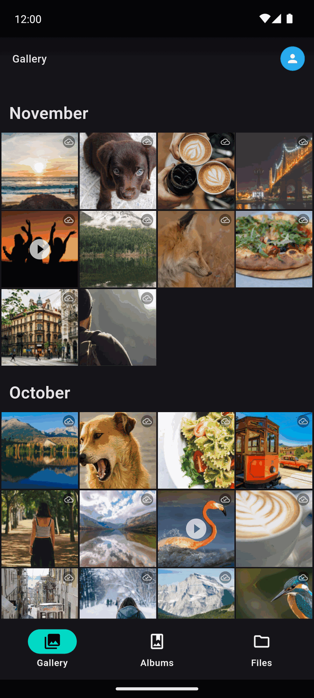
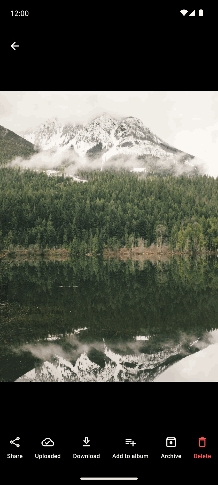
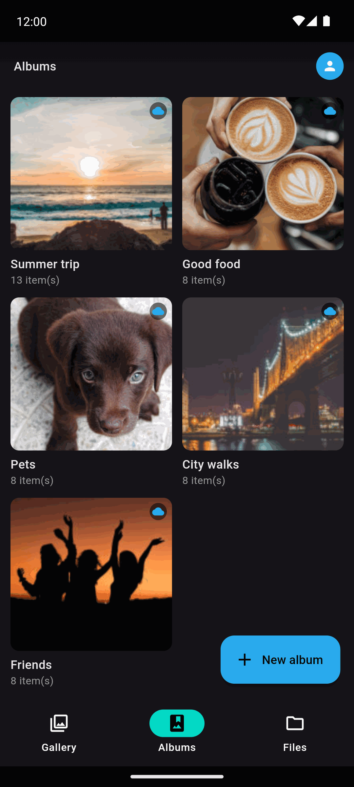
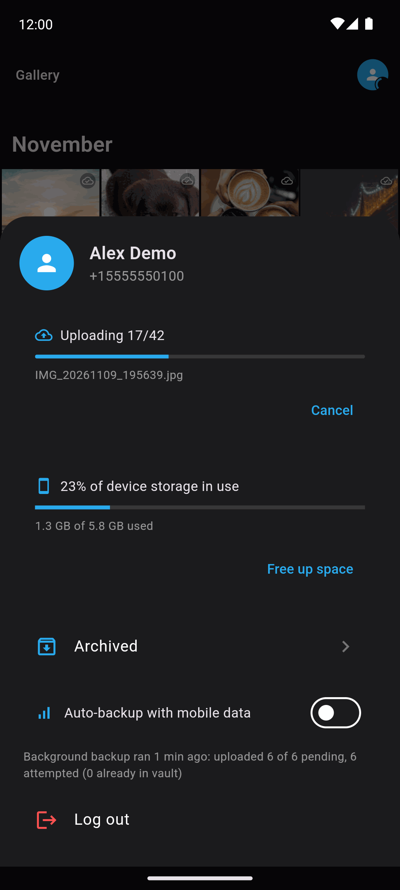
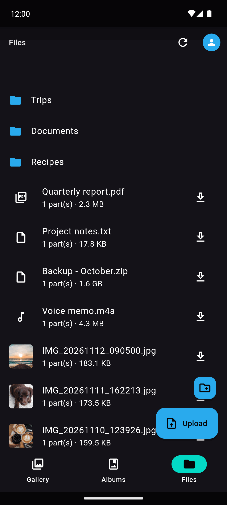
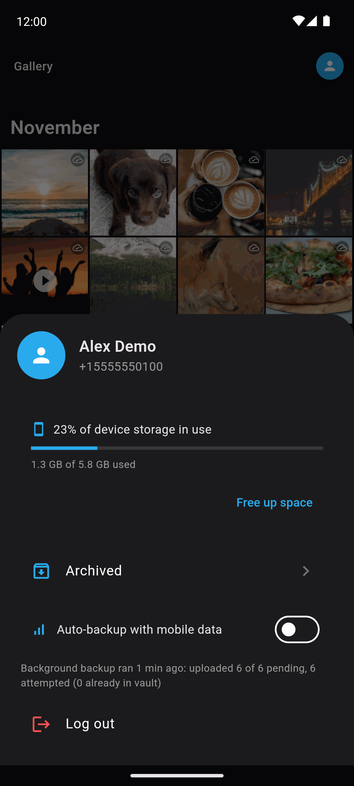

<div align="center">


# TeleVault

**A gallery and file manager that stores your files in your own Telegram account.**

[](LICENSE)
[](https://github.com/masu-code/tele-vault/releases/latest)
[](https://apps.obtainium.imranr.dev/redirect?r=obtainium://add/https://github.com/masu-code/tele-vault)

</div>

## What it is

TeleVault turns your Telegram **Saved Messages** into a photo and file library. It talks to Telegram directly over MTProto with your own account, so there is no TeleVault server and no extra subscription: your files, and the index that organizes them, live in your own Telegram cloud.

It is built for Android (a Windows build also compiles). It works like a photo backup app: a single timeline for what is on the phone and what is in the cloud, automatic background backup, and the option to free local space once things are safely uploaded.

## Features

- **Unified gallery.** Device and cloud items in one timeline, grouped by month, with instant previews and no grey tiles.
- **Background backup.** Photos and albums are uploaded automatically, even with the app closed (WorkManager), with a progress notification and a Wi-Fi / mobile data gate.
- **Deduplication.** Uploads are matched against the cloud index, so a reinstall does not re-upload your library.
- **Portable index.** The index is stored in Telegram, so it survives reinstalls and follows you across devices.
- **Fast native crypto.** AES-256 (IGE and CTR) and SHA-256 run natively through FFI, using ARMv8 Crypto Extensions or AES-NI.
- **Thumbnail packs and backfill.** Previews are shipped in compact packs, and an in-app backfill builds them for files already in the cloud.
- **Video player.** Tap-to-seek, fullscreen and hardware decoding.
- **Albums, archive and "Free up space".** Organize, archive, and reclaim device storage for items confirmed in the cloud.
- **Large files.** Files above Telegram's size limit are split and reassembled transparently.
- **Bring your own API credentials.** Nothing is bundled; each user enters their own `api_id` and `api_hash`.

## Screenshots

Taken from a demo library of free sample photos (see [`tool/demo/photos/CREDITS.md`](tool/demo/photos/CREDITS.md)), never from a real library.

| Gallery | Viewer | Albums |
|---|---|---|
|  |  |  |

| Backup | Files | Account |
|---|---|---|
|  |  |  |

To regenerate them (Android emulator only, never a real phone): `tool/demo/screenshots.ps1`, then `python tool/demo/optimize_screenshots.py`.

## Install

**From GitHub Releases.** Download the APK for your device from the [latest release](https://github.com/masu-code/tele-vault/releases/latest). Most modern phones need `arm64-v8a`; the `universal` APK works anywhere. Verify the download against `SHA256SUMS.txt`, then allow installs from your browser or file manager when Android asks.

**With Obtainium** (updates handled for you): [add TeleVault to Obtainium](https://apps.obtainium.imranr.dev/redirect?r=obtainium://add/https://github.com/masu-code/tele-vault), or add the repository URL `https://github.com/masu-code/tele-vault` manually.

On some Android skins (for example MIUI) background backup also requires enabling autostart and disabling battery restrictions for the app.

## Getting your Telegram API credentials

TeleVault uses your own Telegram application identity instead of a shared one.

1. Open <https://my.telegram.org> and log in with your phone number.
2. Choose **API development tools**.
3. Create an application. Any title and short name work. Avoid the word "telegram" in the title and turn off any VPN while submitting, otherwise the site may return an unhelpful `ERROR`.
4. Copy the **App api_id** and **App api_hash**.
5. Open TeleVault, paste both values on the first screen, then sign in with your phone number, the code Telegram sends you, and your 2FA password if you have one.

Treat the `api_hash` like a secret. It is stored only on your device, in the app's local preferences.

## Architecture

- **Isolates.** The UI isolate stays free of heavy work. Uploads, downloads, thumbnail encoding and index decode/merge/encode each run in their own isolates, and the headless backup entrypoint (WorkManager) rebuilds the same stack without a UI.
- **MTProto.** `packages/tg` is a vendored fork of [`tg`](https://github.com/telegramflutter/tg) 0.0.20, a pure Dart MTProto client. The fork fixes hot paths (key schedules, allocations, receive buffering), uses a secure RNG, authenticates incoming frames, and adds liveness handling. See [`packages/tg/VENDORED.md`](packages/tg/VENDORED.md) for the full list.
- **Native crypto.** `packages/tv_crypto` provides AES-IGE, AES-CTR and SHA-256 in C, built by a Dart build hook and called through FFI. It selects ARMv8 Crypto Extensions or AES-NI at runtime and falls back to portable code. The backend is cross-checked against the pure Dart implementation at startup and is dropped if the check fails.
- **Index in Telegram.** The library structure (folders, files, albums and which Telegram messages hold each part) is a JSON document kept in Saved Messages and found by a marker caption. It is cached locally, written conditionally, and merged three-way when devices change it concurrently. `packages/tv_core` holds these models.
- **Previews.** Every item carries a tiny [ThumbHash](https://github.com/evanw/thumbhash) in the index, so a placeholder can be drawn before any image is downloaded. Real thumbnails come from local thumbnail packs and a prefetcher, so scrolling does not wait on the network.

## Privacy and security

- Your data lives in **your own Telegram account**. TeleVault has no server, no analytics and no accounts of its own.
- Traffic uses Telegram's **MTProto** protocol directly from your device to Telegram.
- Telegram **cloud chats, including Saved Messages, are not end-to-end encrypted**. They are encrypted client-to-server, and Telegram can technically read what you store there. TeleVault does not add its own encryption layer on top, so do not store anything you would not trust Telegram with.
- Your session (authorization key) is stored on the device. Anyone with access to the device storage could use it; you can end it from Telegram under Settings, Devices.
- The app requests media permissions to back up your photos and videos, and internet access to reach Telegram.
- A fork of an MTProto client is security-sensitive code that has had limited independent review. Please report vulnerabilities privately through GitHub security advisories rather than public issues.

## Build from source

Requirements:

- Flutter **3.44.2** (stable), Dart SDK `^3.12.2`. The same version is pinned in `.github/workflows/`.
- Android: Android SDK, JDK 17, and the Android NDK (Flutter selects the version; Gradle installs it on first build). The `tv_crypto` build hook compiles C for each target ABI with the NDK toolchain.
- Windows (optional): Visual Studio 2022 with the "Desktop development with C++" workload. The hook invokes MSVC `cl.exe` directly, which also works when the project path contains spaces. If Windows Smart App Control is on, it may block the freshly built unsigned DLLs.

```bash
git clone https://github.com/masu-code/tele-vault.git
cd tele-vault
flutter pub get
flutter run                      # debug build on a connected device
flutter build apk --release --split-per-abi
```

Local release builds are signed with the debug key unless `android/key.properties` exists (see `android/app/build.gradle.kts`). Judge performance only with `--profile` or `--release` builds, never `--debug`.

Run the tests with `flutter analyze lib`, `flutter test`, and `dart test` inside `packages/tg`. See [CONTRIBUTING.md](CONTRIBUTING.md).

## Versioning

TeleVault follows [Semantic Versioning](https://semver.org/) and [Conventional Commits](https://www.conventionalcommits.org/). Releases are cut by pushing a `vX.Y.Z` tag, which builds signed APKs and publishes a GitHub Release from the matching [CHANGELOG](CHANGELOG.md) section. While the major version is 0, minor releases may include breaking changes.

## License

MIT, see [LICENSE](LICENSE). Copyright (c) 2026 Samuel Contreras.

Third-party code keeps its own licenses:

- `packages/tg` is derived from `tg` by Mahdi K. Fard, MIT (kept in `packages/tg/LICENSE`).
- `packages/tv_core` includes a Dart port of ThumbHash by Evan Wallace, MIT (`packages/tv_core/LICENSE-THIRD-PARTY`).
- All Dart and Flutter dependencies are listed in `pubspec.yaml` and are under their own licenses (mostly MIT, BSD or Apache-2.0). The prebuilt libmpv/FFmpeg binaries bundled by `media_kit_libs_*` have their own upstream licenses; check them before redistributing builds.

## Credits

Built on the work of: [`tg`](https://github.com/telegramflutter/tg) and [`t`](https://pub.dev/packages/t) (MTProto client and TL types), [media_kit](https://github.com/media-kit/media-kit) (video), [photo_manager](https://pub.dev/packages/photo_manager) (device gallery), [Riverpod](https://riverpod.dev/) (state), [workmanager](https://pub.dev/packages/workmanager) (background work), [sqflite](https://pub.dev/packages/sqflite), [flutter_local_notifications](https://pub.dev/packages/flutter_local_notifications), [image](https://pub.dev/packages/image), [ThumbHash](https://github.com/evanw/thumbhash), and Flutter itself.

Demo photos in the screenshots: free CC0 sample photos from Wikimedia Commons (mostly Unsplash photographers; Lorem Picsum, the intended source, was unreachable), see [`tool/demo/photos/CREDITS.md`](tool/demo/photos/CREDITS.md).

## Disclaimer

TeleVault is an independent project. It is **not affiliated with, endorsed by, or sponsored by Telegram**. "Telegram" is a trademark of its respective owner. Use of the Telegram API is subject to Telegram's [API Terms of Service](https://core.telegram.org/api/terms). You are responsible for how you use your account; the software is provided as is, without warranty.
